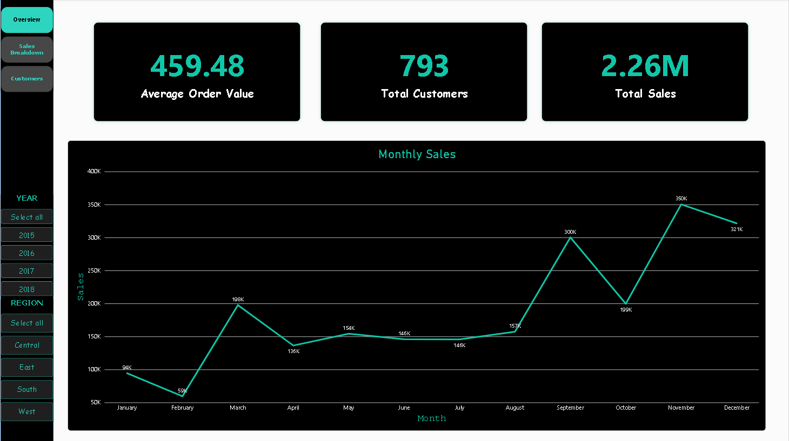
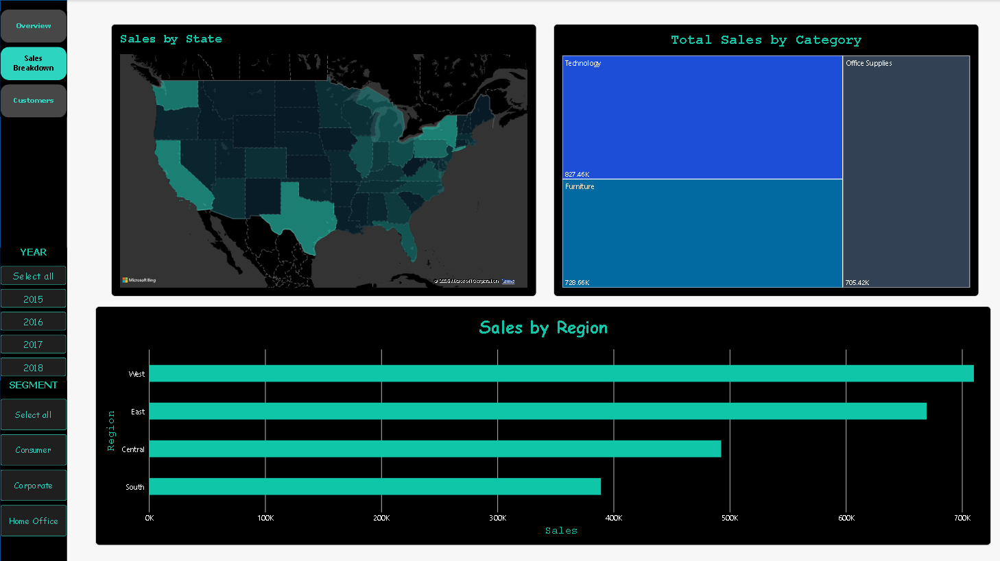
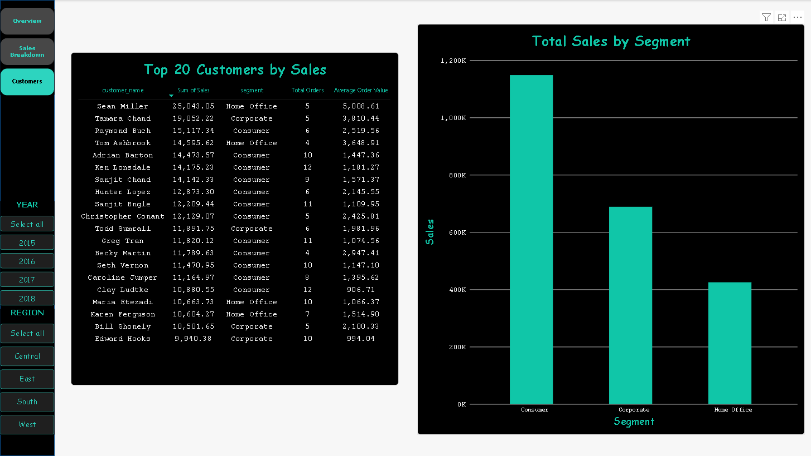

# Superstore Sales Dashboard (Power BI)

A three-page, interactive Power BI dashboard built on 9,800 rows of Superstore sales data. It answers three questions: how is the business doing, where and what is it selling, and who is buying.

## Preview

**Overview**

**Sales Breakdown**

**Customers**

## What It Shows

| Page | Visuals | Question it answers |
|---|---|---|
| Overview | KPI cards (Total Sales, Total Customers, Average Order Value), monthly sales line chart | How is the business doing overall? |
| Sales Breakdown | Filled map by state, sales by region, sales by category | Where and what are we selling? |
| Customers | Top 20 customers table (sales, segment, orders, average order value), sales by segment | Who is driving sales? |

Interactivity: a Year slicer synced across all pages, a Region slicer on Overview and Customers, a Segment slicer on Sales Breakdown, and page navigation buttons.

## Key Insights

1. **Sales are strongly seasonal.** September to December brings in about 52% of all sales (roughly $1.17M of $2.26M), with November the peak at about $350K. February is the weakest month at about $59K.
2. **Sales grew from about $480K in 2015 to about $722K in 2018 (+50%),** with a small dip in 2016. The monthly chart combines all years.
3. **Sales are concentrated geographically.** California and New York together account for about a third of sales ($446K and $306K). West and East are the strongest regions, and South is the weakest at about $389K, roughly 55% of West.
4. **South's gap is order volume, not order size.** South's average order value (about $480) is higher than West's (about $448), but it has about half as many orders (810 vs. 1,587).
5. **Technology leads, but the categories are close.** Technology is about 37% of sales ($827K), Furniture 32% ($729K) and Office Supplies 31% ($705K), so no single category dominates.
6. **There are two routes to the top of the customer list.** Sean Miller ranks first with only 5 orders at about $5,009 each, while Ken Lonsdale reaches the top 10 through 12 orders at about $1,181 each.

## How I Built It

- **Data:** [Superstore Sales Dataset](https://www.kaggle.com/datasets/rohitsahoo/sales-forecasting) from Kaggle, loaded into MySQL. Dates were converted from text (DD/MM/YYYY) to proper date types in SQL before the data reached Power BI.
- **Connection:** Power BI connects directly to the MySQL database.
- **DAX measures:**

| Measure | Logic |
|---|---|
| Total Customers | Distinct count of customer_id |
| Total Orders | Distinct count of order_id |
| Average Order Value | Total sales divided by distinct orders |

- **Design choices:** teal and black theme, a left strip holding the navigator and slicers, a table for the customer view because it can show several metrics per customer, and a map for state-level patterns. The map's color scale was adjusted so California and New York don't wash out the mid-sized states.

## Notes

- Download `superstore-dashboard.pbix` and open it in the free Power BI Desktop to explore the interactive version. Hold **Ctrl** and click to use the navigation buttons.
- The report was built against a local MySQL database, so **Refresh will not work on other machines**. The data is stored in the file.
- This dataset has no profit column, so the analysis is revenue-based.

## What I Learned

- DAX measures recalculate based on the visual they sit in, so one measure works on a card and in a table without a GROUP BY. This is a different mindset from SQL.
- Aggregating inside Power Query would have collapsed the raw rows and broken the other visuals, so the calculations live in measures instead.
- Outliers like California and New York can flatten a color scale, so the map's scale needed adjusting.

## Related Projects

- [SQL analysis](https://github.com/earl-patawaran/superstore-sql-analysis): 10 business questions answered in SQL on the same data
- [Excel analysis](https://github.com/earl-patawaran/superstore-excel-analysis): pivot tables and a lookup tool on the same data
